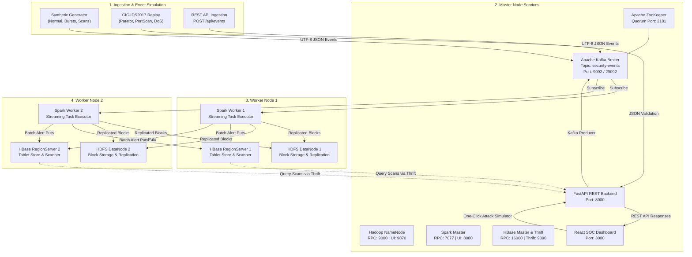
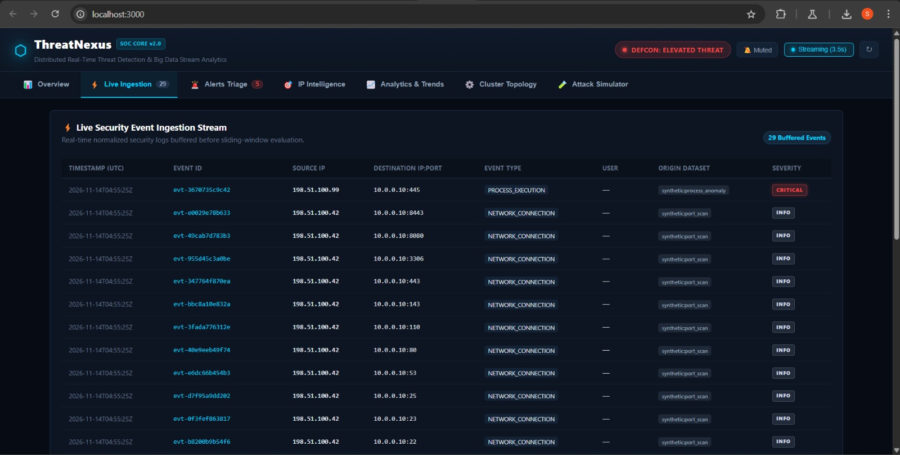
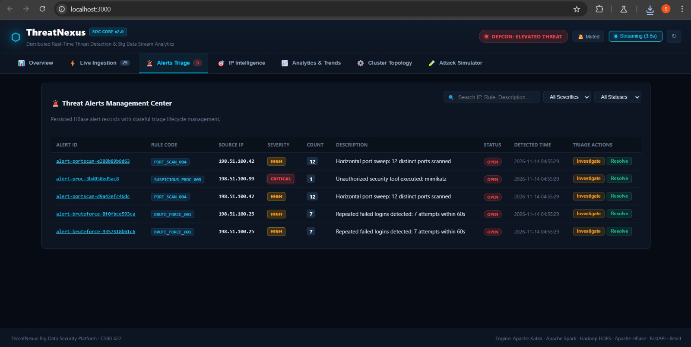
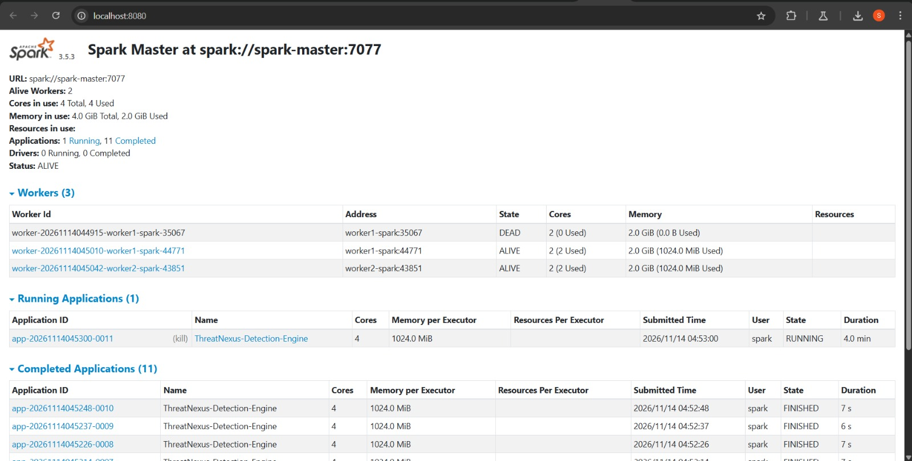
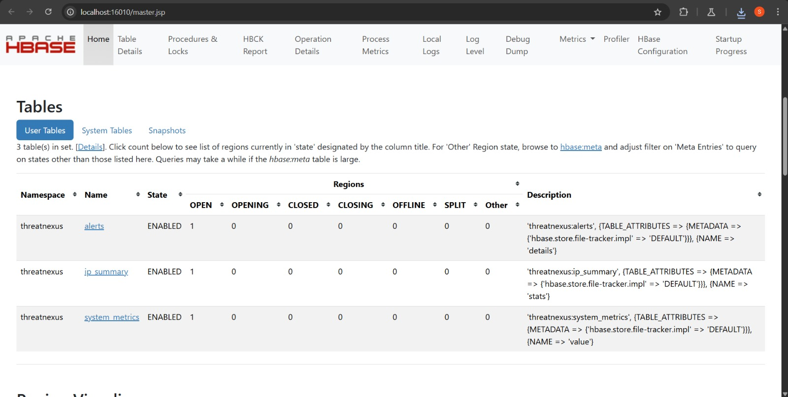

# ThreatNexus
### Distributed Real-Time Cybersecurity Threat Detection & Log Analytics Platform

[](https://spark.apache.org/)
[](https://kafka.apache.org/)
[](https://hadoop.apache.org/)
[](https://hbase.apache.org/)
[](https://fastapi.tiangolo.com/)
[](https://react.dev/)
[](https://www.docker.com/)
[](https://www.python.org/)

> **Course:** CSBB 422 · Big Data & Distributed Computing  
> **Degree:** B.Tech — Computer Science & Engineering (Semester 7)  
> **Topology:** Distributed Cluster (**1 Master Node + 2 Worker Nodes**), expandable to $N$ nodes.

---

## Project Overview

**ThreatNexus** is a distributed cybersecurity threat detection and log analytics platform developed for **CSBB 422: Big Data & Distributed Computing**. 

The project demonstrates a complete real-time big data processing pipeline built using **Apache Kafka**, **Apache Spark Structured Streaming**, **Hadoop HDFS**, and **Apache HBase**, managed through a custom **FastAPI** backend and **React** SOC web dashboard.

### System Specifications & Setup
- **Master Node:** Orchestrates ZooKeeper, Kafka Broker, HDFS NameNode, Spark Master, HBase Master & Thrift Gateway, backend API, and React frontend.
- **Worker Nodes (Worker 1 & Worker 2):** Run distributed workers including **HDFS DataNodes** (block storage & 2x replication), **Spark Workers** (distributed streaming task execution), and **HBase RegionServers** (distributed NoSQL table splits).
- **Deployment Flexibility:** Can be deployed across **3 physical computers over LAN** or simulated on a **single PC across multiple terminals** using Docker Compose namespaces (`-p threatnexus-master`, `-p threatnexus-worker1`, `-p threatnexus-worker2`) and non-conflicting port offsets.
- **Web Interface:** Interactive dark-mode SOC dashboard for live log streaming, alert management, and one-click attack simulation.

---

## Table of Contents
1. [Introduction & Problem Statement](#1-introduction--problem-statement)
2. [Distributed Cluster Topology: Master Node vs Worker Nodes](#2-distributed-cluster-topology-master-node-vs-worker-nodes)
3. [End-to-End System Architecture](#3-end-to-end-system-architecture)
4. [Visual Demonstration & Screenshots](#4-visual-demonstration--screenshots)
5. [Real-Time Detection Engine & Heuristics](#5-real-time-detection-engine--heuristics)
6. [Hardware & Software Prerequisites](#6-hardware--software-prerequisites)
7. [Basic Usage Commands & Explanations (Hadoop, Kafka, Spark, HBase)](#7-basic-usage-commands--explanations-hadoop-kafka-spark-hbase)
8. [Step-by-Step Instructions to Run](#8-step-by-step-instructions-to-run)
   - [Mode 1: Single-PC Multi-Terminal Cluster Simulation (Recommended)](#mode-1-single-pc-multi-terminal-cluster-simulation-recommended)
   - [Mode 2: Physical Multi-PC LAN Cluster](#mode-2-physical-multi-pc-lan-cluster)
   - [Mode 3: Monolithic Single-Stack Mode](#mode-3-monolithic-single-stack-mode)
9. [Automated Verification & Pipeline Testing](#9-automated-verification--pipeline-testing)
10. [Event Replay & Attack Simulator](#10-event-replay--attack-simulator)
11. [Big Data Storage Schemas](#11-big-data-storage-schemas)
12. [Web UIs & Port Reference](#12-web-uis--port-reference)
13. [Repository Structure](#13-repository-structure)
14. [Project Demonstration & Verification Walkthrough](#14-project-demonstration--verification-walkthrough)

---

## 1. Introduction & Problem Statement

Modern enterprise networks generate millions of heterogeneous event logs per second (firewalls, Active Directory, server authentication, network flows). Traditional batch log analyzers suffer from latency gaps of 15–60 minutes, enabling attackers to execute privilege escalation and lateral movement undetected.

**ThreatNexus** solves this challenge by deploying a production-style distributed big data pipeline:
- **High-Throughput Ingestion:** Ingests high-velocity JSON logs into **Apache Kafka** with multi-broker partition scalability.
- **Micro-Batch Stream Analytics:** **Apache Spark Structured Streaming** processes incoming events within sliding event-time windows and a 2-minute watermark for late-arriving events.
- **Heuristic Threat Detection:** Evaluates sliding-window rules to detect SSH brute-force attempts, network port sweeps, volumetric traffic surges, denylisted processes (`mimikatz`), and labelled **CIC-IDS2017** benchmark attacks.
- **Dual-Layer Big Data Storage:**
  - **Cold Archive (Hadoop HDFS):** Stores raw and curated logs in date-partitioned JSON files (`/threatnexus/events/date=YYYY-MM-DD/`) with replication factor 2.
  - **Hot Analytics (Apache HBase):** Fast NoSQL random-access database for alerts and IP threat profiles using reverse-timestamp row keys for instant latest-first queries.
- **Operational SOC Dashboard:** High-performance **FastAPI** asynchronous backend serving an enterprise dark-mode **React** SOC visualizer with real-time KPI metrics, MITRE ATT&CK alignment, and one-click attack simulation.

---

## 2. Distributed Cluster Topology: Master Node vs Worker Nodes

To fulfill the requirement of **1 Master Node + at least 2 Worker Nodes**, ThreatNexus splits computational load, storage replication, and coordination across distinct roles:

```
┌─────────────────────────────────────────────────────────────────────────────────────────────────┐
│                                          MASTER NODE                                            │
│                                    (Physical PC or Terminal 1)                                  │
│                                                                                                 │
│  • Apache ZooKeeper (Quorum Coordinator)             [Port 2181]                                │
│  • Apache Kafka (Event Ingestion Broker)             [Port 9092, 29092]                         │
│  • Hadoop HDFS NameNode (Metadata & Block Manager)   [Port 9000 RPC, 9870 UI]                   │
│  • Apache Spark Master (Standalone Cluster Manager)  [Port 7077 RPC, 8080 UI]                   │
│  • Apache HBase Master (Schema & Region Allocator)   [Port 16000 RPC, 16010 UI]                 │
│  • Apache HBase Thrift (REST/Python Query Gateway)   [Port 9090]                                │
│  • FastAPI Analytics REST Backend                    [Port 8000]                                │
│  • React SOC Web Dashboard Interface                 [Port 3000]                                │
└────────────────────────────────────────────────┬────────────────────────────────────────────────┘
                                                 │
                                 Private Network / Docker Bridge
                                       (`threatnexus-net`)
                                                 │
            ┌────────────────────────────────────┴────────────────────────────────────┐
            │                                                                         │
┌───────────▼─────────────────────────────┐               ┌───────────────────────────▼─────────────┐
│              WORKER NODE 1              │               │              WORKER NODE 2              │
│       (Physical PC or Terminal 2)       │               │       (Physical PC or Terminal 3)       │
│                                         │               │                                         │
│ • Hadoop HDFS DataNode 1                │               │ • Hadoop HDFS DataNode 2                │
│   Stores & replicates raw event blocks  │               │   Stores & replicates raw event blocks  │
│   Ports: 9864 (HTTP), 9866 (Data)       │               │   Ports: 9865 (HTTP), 9867 (Data)*      │
│                                         │               │                                         │
│ • Apache Spark Worker 1                 │               │ • Apache Spark Worker 2                 │
│   Executes streaming micro-batch tasks  │               │   Executes streaming micro-batch tasks  │
│   2 Cores, 2 GB RAM [Port 8081 UI]      │               │   2 Cores, 2 GB RAM [Port 8082 UI]*     │
│                                         │               │                                         │
│ • Apache HBase RegionServer 1           │               │ • Apache HBase RegionServer 2           │
│   Serves tablet splits & table queries  │               │   Serves tablet splits & table queries  │
│   Ports: 16020 (RPC), 16030 (Info)      │               │   Ports: 16021 (RPC), 16031 (Info)*     │
└─────────────────────────────────────────┘               └─────────────────────────────────────────┘
(* Note: In Single-PC simulation mode, Worker 2 uses port offsets to prevent host port collisions).
```

### How Storage & Compute Are Distributed Across Worker Nodes
1. **HDFS Storage Partitioning & Replication:**
   - The NameNode (on Master) maintains the file system namespace.
   - When Spark writes raw event logs to `/threatnexus/events/date=YYYY-MM-DD/`, the files are chunked into blocks and stored across **DataNode 1** (Worker 1) and **DataNode 2** (Worker 2).
   - With `HDFS_CONF_dfs_replication: 2`, each block is safely replicated across both workers, ensuring fault tolerance if one worker disconnects.
2. **Spark Distributed Micro-Batch Execution:**
   - The Spark Master (on Master) coordinates resource scheduling.
   - **Worker 1** and **Worker 2** each register 2 cores and 2 GB RAM with the master.
   - Incoming micro-batches from Kafka topic `security-events` are divided into RDD partitions executed concurrently by Spark Executors running on Worker 1 and Worker 2.
3. **HBase Region Sharding:**
   - The HBase Master (on Master) assigns region tablets.
   - Tables (`threatnexus:alerts`, `threatnexus:ip_summary`, `threatnexus:system_metrics`) are sharded across **RegionServer 1** (Worker 1) and **RegionServer 2** (Worker 2), distributing read/write throughput.

---

## 3. End-to-End System Architecture



---

## 4. Visual Demonstration & Screenshots

The working system components and visual dashboards captured during live cluster operation are shown below:

| Component | Description | Screenshot Preview |
| :--- | :--- | :--- |
| **1. React SOC Dashboard** | Real-time security telemetry, active threat counter, MITRE ATT&CK matrix, and threat velocity sparklines. |  |
| **2. Live Security Events** | High-velocity streaming log feed received directly from the Kafka `security-events` topic. |  |
| **3. Alerts Triage Center** | Detected security incidents with severity filters (`CRITICAL`, `HIGH`, `MEDIUM`), event counts, and status updates. |  |
| **4. One-Click Attack Simulator** | Interactive simulator to trigger SSH brute force, TCP port sweeps, and suspicious processes directly from UI. |  |
| **5. HDFS NameNode Web UI** | Proves distributed fault-tolerant storage showing **`Live datanodes (2)`** (`worker1-datanode`, `worker2-datanode`). |  |
| **6. Spark Master Web UI** | Spark cluster manager showing **2 registered worker nodes** (`worker1-spark`, `worker2-spark`) and streaming execution. |  |
| **7. Spark Worker 1 Web UI** | Worker 1 executor console (`http://localhost:8081`) confirming 2 cores allocated and running streaming executor tasks. |  |
| **8. Spark Worker 2 Web UI** | Worker 2 executor console (`http://localhost:8082`) confirming 2 cores allocated and concurrent streaming execution. |  |
| **9. HBase Master Web UI** | Distributed NoSQL status showing **2 live RegionServers** and initialized `threatnexus:*` schema tables. |  |
| **10. Automated Verification Suite** | Complete automated integration test suite passing **11/11 test cases (100% pass rate)**. |  |

---

## 5. Real-Time Detection Engine & Heuristics

ThreatNexus processes incoming events against 5 real-time detection rules in `spark/stream_processor.py`:

| Rule ID | Name | Trigger Condition | Window | Severity | Action Taken |
| :--- | :--- | :--- | :--- | :--- | :--- |
| **`BRUTE_FORCE_001`** | SSH / Auth Brute Force | $\ge 5$ failed login attempts from same `source_ip` | 60s sliding (30s slide) | **HIGH** | Emits alert to HBase; updates IP failure count |
| **`PORT_SCAN_004`** | Horizontal Port Scan | $\ge 10$ distinct destination ports contacted by same `source_ip` | 60s sliding (30s slide) | **HIGH** | Flags horizontal reconnaissance sweep |
| **`TRAFFIC_SPIKE_003`** | Volumetric Traffic Surge | $\ge 20$ events from single `source_ip` | 60s sliding (30s slide) | **MEDIUM** | Flags anomalous traffic / potential DoS flow |
| **`SUSPICIOUS_PROC_005`** | Malicious Process Execution | Process name matches denylist (`mimikatz`, `nmap`, `nc.exe`, `hydra`, `metasploit`) | Instant (per event) | **CRITICAL** | Immediate priority alert emission |
| **`CIC_DATASET_ATTACK_006`** | Benchmark Dataset Attack | Event labelled with known CIC-IDS2017 attack flow category | Instant (per event) | **HIGH** | Correlates and alerts on benchmark intrusion flows |

---

## 6. Hardware & Software Prerequisites

### Recommended Machine Specifications
- **Operating System:** Windows 10/11 64-bit with WSL2 (Ubuntu 20.04/22.04/24.04), macOS, or Linux.
- **CPU:** Quad-Core (8 threads) minimum; 6–8 cores recommended.
- **RAM:** Minimum **16 GB RAM** (24–32 GB recommended).
  - *Windows WSL2 Users:* Configure `C:\Users\<Username>\.wslconfig` to allocate at least 12 GB RAM:
    ```ini
    [wsl2]
    memory=12GB
    processors=6
    swap=4GB
    ```
- **Disk Storage:** At least **30 GB free SSD space** for Docker images, HDFS blocks, and HBase tables.
- **Installed Software:** Docker Desktop with Compose v2, Python 3.10+, and `curl`.

---

## 7. Basic Usage Commands & Explanations (Hadoop, Kafka, Spark, HBase)

The following commands provide administrative inspection, health verification, and data manipulation across each core big data component in the cluster:

### 1. Apache Hadoop (HDFS) Commands
```bash
# A. Generate complete cluster storage report (shows Live DataNodes, Capacity, and Block health):
docker compose -p threatnexus-master -f docker-compose.master.yml exec namenode hdfs dfsadmin -report

# B. Check HDFS Safe Mode status (Safe mode prevents modifications during initialization):
docker compose -p threatnexus-master -f docker-compose.master.yml exec namenode hdfs dfsadmin -safemode get

# C. List files and directories in HDFS:
docker compose -p threatnexus-master -f docker-compose.master.yml exec namenode hdfs dfs -ls -R /threatnexus

# D. View contents of date-partitioned raw event log stored by Spark in HDFS:
docker compose -p threatnexus-master -f docker-compose.master.yml exec namenode hdfs dfs -cat /threatnexus/events/date=2026-11-12/part-00000-*.json | head -n 5

# E. Create a new directory in HDFS:
docker compose -p threatnexus-master -f docker-compose.master.yml exec namenode hdfs dfs -mkdir -p /threatnexus/manual_backup

# F. Check disk usage per directory:
docker compose -p threatnexus-master -f docker-compose.master.yml exec namenode hdfs dfs -du -h /threatnexus
```

### 2. Apache Kafka Commands
```bash
# A. List all active Kafka topics:
docker compose -p threatnexus-master -f docker-compose.master.yml exec kafka kafka-topics --bootstrap-server kafka:29092 --list

# B. Describe the 'security-events' topic (shows partitions, replication factor, leader):
docker compose -p threatnexus-master -f docker-compose.master.yml exec kafka kafka-topics --bootstrap-server kafka:29092 --describe --topic security-events

# C. Consume and print live events from beginning of the topic:
docker compose -p threatnexus-master -f docker-compose.master.yml exec kafka kafka-console-consumer --bootstrap-server kafka:29092 --topic security-events --from-beginning --max-messages 5

# D. Manually publish a test event to Kafka via console producer:
docker compose -p threatnexus-master -f docker-compose.master.yml exec -i kafka kafka-console-producer --bootstrap-server kafka:29092 --topic security-events
# (Type JSON string like: {"event_id":"manual-01","source_ip":"192.168.1.50","event_type":"AUTHENTICATION","status":"success"} then press Enter and Ctrl+C)
```

### 3. Apache Spark Commands
```bash
# A. Check Spark Master status, alive workers, and active applications via REST API:
curl -s http://localhost:8080/json/ | python3 -m json.tool

# B. Inspect Spark Structured Streaming logs:
docker compose -p threatnexus-master -f docker-compose.master.yml logs --tail=50 spark-streaming

# C. View Spark Web UI directly in browser:
# Open http://localhost:8080 (Master), http://localhost:8081 (Worker 1), http://localhost:8082 (Worker 2)
```

### 4. Apache HBase Shell Commands
```bash
# A. Launch interactive HBase Shell:
docker compose -p threatnexus-master -f docker-compose.master.yml exec hbase-master /usr/local/hbase/bin/hbase shell

# Inside the HBase Shell (or run as one-liner):
# Check cluster status and live RegionServers:
status

# List all user tables:
list

# Describe table schema and column families:
describe 'threatnexus:alerts'

# Scan first 3 alerts with reverse-timestamp keys:
scan 'threatnexus:alerts', {LIMIT => 3}

# Get total count of rows in the table:
count 'threatnexus:alerts'

# Insert a manual record into HBase:
put 'threatnexus:alerts', 'test_row_01', 'details:severity', 'CRITICAL'
put 'threatnexus:alerts', 'test_row_01', 'details:description', 'Manual verification test record'

# Retrieve the inserted record:
get 'threatnexus:alerts', 'test_row_01'

# Exit the shell:
exit
```

---

## 8. Step-by-Step Instructions to Run

ThreatNexus provides two single-PC execution modes, plus physical multi-node LAN deployment:

```
┌────────────────────────────────────────────────────────────────────────┐
│                        CHOOSE YOUR EXECUTION MODE                      │
├───────────────────────────────────┬────────────────────────────────────┤
│ Mode 1: Multi-Terminal Simulation │ Mode 2: Physical Multi-PC Cluster  │
│ (1 Master + 2 Workers on 1 PC)    │ (3 separate laptops over LAN)      │
│ ★ RECOMMENDED FOR DEMO            │ For physical multi-PC setup        │
└───────────────────────────────────┴────────────────────────────────────┘
```

---

### Mode 1: Single-PC Multi-Terminal Cluster Simulation (Recommended)

Simulates the physical 3-node cluster (**1 Master Node + 2 Worker Nodes**) on a single machine across 4 terminal windows using Docker Compose namespaces and isolated port offsets over a shared bridge network (`threatnexus-net`).

#### Pre-Flight Step: Clean any existing containers
In PowerShell or WSL2 bash:
```bash
docker compose -p threatnexus-worker1 -f docker-compose.worker.yml down -v --remove-orphans
docker compose -p threatnexus-worker2 -f docker-compose.worker.yml down -v --remove-orphans
docker compose -p threatnexus-master -f docker-compose.master.yml down -v --remove-orphans
```

---

#### Terminal 1: Launch Master Node Stack
The Master node runs ZooKeeper, Kafka Broker, HDFS NameNode, HBase Master & Thrift, Spark Master, Spark Streaming Engine, FastAPI, and React SOC Dashboard.

**In Windows PowerShell:**
```powershell
docker compose -p threatnexus-master -f docker-compose.master.yml up -d --build
docker compose -p threatnexus-master -f docker-compose.master.yml ps
```
*(Or in WSL2 bash: `docker compose -p threatnexus-master -f docker-compose.master.yml up -d --build`)*

---

#### Terminal 2: Launch Worker Node 1
Worker 1 runs HDFS DataNode 1, Spark Worker 1, and HBase RegionServer 1.

**In Windows PowerShell:**
```powershell
$env:WORKER_HOSTNAME = "worker1"
$env:DATANODE_HTTP_PORT = "9864"
$env:DATANODE_DATA_PORT = "9866"
$env:SPARK_WORKER_UI_PORT = "8081"
$env:REGIONSERVER_PORT = "16020"
$env:REGIONSERVER_INFO_PORT = "16030"
docker compose -p threatnexus-worker1 -f docker-compose.worker.yml up -d --build
docker compose -p threatnexus-worker1 -f docker-compose.worker.yml ps
```

**In WSL2 bash:**
```bash
WORKER_HOSTNAME=worker1 DATANODE_HTTP_PORT=9864 DATANODE_DATA_PORT=9866 SPARK_WORKER_UI_PORT=8081 REGIONSERVER_PORT=16020 REGIONSERVER_INFO_PORT=16030 docker compose -p threatnexus-worker1 -f docker-compose.worker.yml up -d --build
```

---

#### Terminal 3: Launch Worker Node 2
Worker 2 runs HDFS DataNode 2, Spark Worker 2, and HBase RegionServer 2 using non-conflicting host port offsets.

**In Windows PowerShell:**
```powershell
$env:WORKER_HOSTNAME = "worker2"
$env:DATANODE_HTTP_PORT = "9865"
$env:DATANODE_DATA_PORT = "9867"
$env:SPARK_WORKER_UI_PORT = "8082"
$env:REGIONSERVER_PORT = "16021"
$env:REGIONSERVER_INFO_PORT = "16031"
docker compose -p threatnexus-worker2 -f docker-compose.worker.yml up -d --build
docker compose -p threatnexus-worker2 -f docker-compose.worker.yml ps
```

**In WSL2 bash:**
```bash
WORKER_HOSTNAME=worker2 DATANODE_HTTP_PORT=9865 DATANODE_DATA_PORT=9867 SPARK_WORKER_UI_PORT=8082 REGIONSERVER_PORT=16021 REGIONSERVER_INFO_PORT=16031 docker compose -p threatnexus-worker2 -f docker-compose.worker.yml up -d --build
```

---

#### Terminal 4: Verification & Live Attack Demonstration
Run the verification checks from WSL2 bash (or PowerShell):

```bash
# 1. Confirm HDFS recognizes both distributed DataNodes and Safe Mode is OFF:
docker compose -p threatnexus-master -f docker-compose.master.yml exec namenode hdfs dfsadmin -report
docker compose -p threatnexus-master -f docker-compose.master.yml exec namenode hdfs dfsadmin -safemode get

# 2. Confirm HBase has 2 live RegionServers and all tables are initialized:
docker compose -p threatnexus-master -f docker-compose.master.yml exec hbase-master bash -c "printf 'status\nlist\n' | /usr/local/hbase/bin/hbase shell -n"

# 3. Stream a synthetic SSH Brute Force attack scenario into the pipeline:
python3 scripts/replay_dataset.py --scenario brute_force --target http://localhost:8000/api/events

# 4. Run the comprehensive automated test suite (11 test cases):
python3 scripts/test_pipeline.py --api http://localhost:8000

# 5. Verify alerts in HBase and date-partitioned JSON files in HDFS:
curl -s http://localhost:8000/api/alerts | python3 -m json.tool
docker compose -p threatnexus-master -f docker-compose.master.yml exec namenode hdfs dfs -ls -R /threatnexus/events
```

---

### Mode 2: Physical Multi-PC LAN Cluster
When deploying across 3 physical lab laptops over a local network (`192.168.1.0/24`):
- **Master PC (`192.168.1.10`):** `cp config/master.env.example .env && docker compose -p threatnexus-master -f docker-compose.master.yml up -d --build`
- **Worker 1 PC (`192.168.1.11`):** `cp config/worker.env.example .env && docker compose -p threatnexus-worker1 -f docker-compose.worker.yml up -d --build`
- **Worker 2 PC (`192.168.1.12`):** `cp config/worker.env.example .env && docker compose -p threatnexus-worker2 -f docker-compose.worker.yml up -d --build`
*(See [docs/DISTRIBUTED_DEPLOYMENT.md](docs/DISTRIBUTED_DEPLOYMENT.md) for full physical LAN guide).*

---

### Mode 3: Monolithic Single-Stack Mode
To run all containers inside a single compose file:
```bash
docker compose up -d --build
docker compose ps
python3 scripts/test_pipeline.py --api http://localhost:8000
```

---

### Stopping the Cluster Cleanly
```bash
docker compose -p threatnexus-worker1 -f docker-compose.worker.yml down
docker compose -p threatnexus-worker2 -f docker-compose.worker.yml down
docker compose -p threatnexus-master -f docker-compose.master.yml down
```
*(Add `-v` if you wish to wipe volume state).*

---

## 9. Automated Verification & Pipeline Testing

ThreatNexus includes an end-to-end verification script ([scripts/test_pipeline.py](scripts/test_pipeline.py)) that executes automated integration tests against live endpoints:

```bash
python3 scripts/test_pipeline.py --api http://localhost:8000
```

### Verified Test Cases:
```
=================================================================
 ThreatNexus End-to-End Pipeline Verification Suite
 Target Endpoint: http://localhost:8000
=================================================================
[PASS] T1: API Health Endpoint Check (HTTP 200, Service: threatnexus-api)
[PASS] T2: Dependency Deep Health Check (Kafka: healthy, HBase: healthy)
[PASS] T3: Valid Event Kafka Ingestion (HTTP 202, ID: test-valid-1794489911)
[PASS] T4: Malformed Event Validation Rejection (HTTP 422 correctly rejected)
[PASS] T5: Ingest Brute Force Attack Sequence (Published 7 failed-login events)
[PASS] T6: Ingest Port Scan Sweep Sequence (Published 12 port scan connection events)
[PASS] T7: Ingest Suspicious Process Event (Published critical process execution event)
[PASS] T8: Metrics Summary API Contract Check (Total Events: 58, Total Alerts: 2)
[PASS] T9: Alerts Query & Filter API Contract (Retrieved 2 alerts)
[PASS] T10: Top IPs Intelligence API Contract (Retrieved 4 profiled IPs)
[PASS] T11: Recent Events Live Stream Buffer (Buffer contains 20 events)
=================================================================
 Test Results: 11/11 Passed (100%)
=================================================================
```

---

## 10. Event Replay & Attack Simulator

The event replay engine ([scripts/replay_dataset.py](scripts/replay_dataset.py)) feeds simulated security scenarios and benchmark datasets into Kafka:

```bash
# 1. Trigger SSH Brute Force attack scenario (7 failed logins)
python3 scripts/replay_dataset.py --scenario brute_force --target http://localhost:8000/api/events

# 2. Trigger Network Port Scan sweep (12 ports)
python3 scripts/replay_dataset.py --scenario port_scan --target http://localhost:8000/api/events

# 3. Trigger Suspicious Process Execution (mimikatz)
python3 scripts/replay_dataset.py --scenario process --target http://localhost:8000/api/events

# 4. Trigger Traffic Event-Rate Surge (25 requests)
python3 scripts/replay_dataset.py --scenario traffic_spike --target http://localhost:8000/api/events

# 5. Replay curated CIC-IDS2017 dataset flow records
python3 scripts/replay_dataset.py --source csv --input data/cic_ids2017_sample.csv --rate 3

# 6. Stream continuous normal background traffic
python3 scripts/replay_dataset.py --scenario normal --rate 2 --loop
```

*Tip: All these scenarios can also be triggered with a single click from the **Attack Simulator** tab in the React Dashboard.*

---

## 11. Big Data Storage Schemas

### Hadoop HDFS Storage Layout
- **Raw Event Logs (JSON partitioned by ingestion date):**
  ```
  hdfs://namenode:9000/threatnexus/events/date=YYYY-MM-DD/part-*.json
  ```
- **Spark Structured Streaming Checkpoint Store:**
  ```
  hdfs://namenode:9000/threatnexus/checkpoints/alerts_v2/
  hdfs://namenode:9000/threatnexus/checkpoints/events_v2/
  ```

### Apache HBase NoSQL Schemas
1. **`threatnexus:alerts`**
   - **Row Key Design:** `{rev_ts}_{alert_id}` where `rev_ts = 9999999999999 - unix_timestamp_ms`. This reverse-timestamp prefix guarantees that simple table scans return newest alerts first with zero index overhead.
   - **Column Family `details:`**
     `alert_id`, `rule_id`, `severity`, `type`, `source_ip`, `description`, `event_count`, `window_start`, `window_end`, `status`, `created_at`
2. **`threatnexus:ip_summary`**
   - **Row Key Design:** `{source_ip}_{YYYY-MM-DD}`
   - **Column Family `stats:`**
     `last_seen`, `last_alert`, `severity`, `event_count`, `failed_logins`
3. **`threatnexus:system_metrics`**
   - **Row Key Design:** `{metric_name}_{time_bucket}`
   - **Column Family `value:`**
     `count`, `rate`, `timestamp`

---

## 12. Web UIs & Port Reference

When the cluster is active, evaluators can inspect every component directly in their web browser:

| Service / Dashboard | Host URL | Node Location | Description & Key Checks |
| :--- | :--- | :--- | :--- |
| **React SOC Dashboard** | [http://localhost:3000](http://localhost:3000) | Master Node | Live incident visualizer, MITRE matrix, alert status toggles |
| **FastAPI Swagger Docs** | [http://localhost:8000/docs](http://localhost:8000/docs) | Master Node | Interactive API exploration and manual event ingestion |
| **HDFS NameNode UI** | [http://localhost:9870](http://localhost:9870) | Master Node | Storage capacity, block allocation, live DataNode list (2 DataNodes) |
| **Spark Master UI** | [http://localhost:8080](http://localhost:8080) | Master Node | Registered workers (worker1, worker2), streaming apps |
| **Spark Worker 1 UI** | [http://localhost:8081](http://localhost:8081) | Worker Node 1 | Worker 1 core allocation and executor memory |
| **Spark Worker 2 UI** | [http://localhost:8082](http://localhost:8082) | Worker Node 2 | Worker 2 core allocation and executor memory (Port 8082 in sim mode) |
| **HBase Master UI** | [http://localhost:16010](http://localhost:16010) | Master Node | Active RegionServers (2 RegionServers), region distribution, tables |

---

## 13. Repository Structure

```
ThreatNexus/
├── backend/                        # FastAPI REST Analytics Backend
│   ├── app/
│   │   ├── main.py                 # API endpoints, Kafka producer, HBase scanner
│   │   └── __init__.py
│   ├── Dockerfile
│   └── requirements.txt
├── config/                         # Distributed Configuration Templates
│   ├── hbase/                      # XML configs for HBase, HDFS, and core-site
│   │   ├── core-site.xml
│   │   ├── hbase-env.sh
│   │   ├── hbase-site.xml
│   │   └── hdfs-site.xml
│   ├── master.env.example          # Sample environment for Master PC
│   ├── worker.env.example          # Sample environment for Worker PCs
│   └── cluster.env.example
├── data/
│   └── cic_ids2017_sample.csv      # Sample CIC-IDS2017 intrusion flow records
├── docs/                           # Comprehensive Project Documentation
│   ├── screenshots/                # Demonstration and verification screenshots
│   │   ├── React_SOC_Dashboard.jpeg
│   │   ├── Live_Security_Events.jpeg
│   │   ├── Alert_Triangle_Center.jpeg
│   │   ├── One_Click_Attack_Simulator.jpeg
│   │   ├── HDFS_Namenode_Web_UI.jpeg
│   │   ├── Spark_Master_Web_UI.jpeg
│   │   ├── Spark_Worker_1_web_UI.jpeg
│   │   ├── Spark_Worker_2_Web_UI.jpeg
│   │   ├── HBASE_Master_Web_UI.jpeg
│   │   └── Automated_Verification_Suite.jpeg
│   ├── API_CONTRACT.md             # Formal REST API request/response contracts
│   ├── ARCHITECTURE.md             # Deep-dive architecture and component design
│   ├── DEMO_SCRIPT.md              # Step-by-step demonstration walkthrough guide
│   ├── DISTRIBUTED_DEPLOYMENT.md   # Complete multi-node and local simulation guide
│   ├── EVENT_SCHEMA.md             # JSON security event specification
│   ├── TESTING.md                  # Comprehensive verification test matrix
│   ├── cluster-inventory.md        # Physical/logical cluster nodes & scaling guide
│   └── versions.md                 # Certified software dependencies matrix
├── frontend/                       # React SOC Web Dashboard
│   ├── src/                        # Dashboard views: Overview, Events, Alerts, IPs
│   ├── package.json
│   ├── vite.config.js
│   └── Dockerfile
├── hbase/
│   └── init_tables.sh              # Idempotent table & namespace creation script
├── scripts/                        # Automation & Testing Tools
│   ├── generate_synthetic.py       # Attack generator (brute force, scan, spikes)
│   ├── replay_dataset.py           # Kafka/HTTP dataset streaming replay tool
│   └── test_pipeline.py            # Automated end-to-end 11-step verification suite
├── spark/                          # Apache Spark Streaming Engine
│   ├── stream_processor.py         # PySpark Structured Streaming threat engine
│   └── Dockerfile
├── .env                            # Active environment configuration
├── .env.example                    # Baseline environment template
├── docker-compose.master.yml       # Compose file for Master node services
├── docker-compose.worker.yml       # Parameterized Compose file for Worker nodes
├── docker-compose.yml              # Monolithic Compose stack (single-PC dev)
└── README.md                       # Main project documentation & submission report
```
---

## 14. Project Demonstration & Verification Walkthrough

The following step-by-step walkthrough outlines how to demonstrate and verify the complete ThreatNexus pipeline:

- **Step 1: Architecture & Pipeline Overview**  
  Review the system architecture: real-time security telemetry is ingested via Kafka, processed through PySpark Structured Streaming using sliding state windows, permanently archived in HDFS for long-term audit compliance, and stored in HBase for sub-second incident queries.

- **Step 2: Distributed Node Registration Verification**  
  Inspect the central web dashboards to confirm the master node and both worker nodes are connected and healthy:
  1. **HDFS NameNode UI** (`http://localhost:9870`): Verify **`Live datanodes (2)`** (`worker1-datanode` and `worker2-datanode`).
  2. **Spark Master UI** (`http://localhost:8080`): Verify **2 alive workers** (`worker1-spark` and `worker2-spark`) with allocated executor memory and cores.
  3. **HBase Master UI** (`http://localhost:16010`): Verify **2 live RegionServers** and user tables (`threatnexus:alerts`, `threatnexus:ip_summary`, `threatnexus:system_metrics`).

- **Step 3: Component CLI Health & Usage Verification**  
  Execute core inspection commands from [Section 7](#7-basic-usage-commands--explanations-hadoop-kafka-spark-hbase):
  - **HDFS**: `hdfs dfsadmin -report` to display block pool and storage utilization.
  - **Kafka**: `kafka-topics --list` to confirm the `security-events` topic is active.
  - **HBase**: `hbase shell` $\to$ `status` and `scan 'threatnexus:alerts', {LIMIT => 3}` to inspect persisted alert rows.

- **Step 4: Live Attack Simulation & Real-Time Stream Detection**  
  Publish a synthetic brute-force authentication sequence using the replay tool or the UI simulator:
  ```bash
  python3 scripts/replay_dataset.py --scenario brute_force
  ```
  Monitor the Spark streaming engine as it ingests the micro-batch and triggers alert rule `BRUTE_FORCE_001` within the 30-second sliding window.

- **Step 5: Distributed Storage Verification (HDFS & HBase)**  
  Confirm data persistence across both storage tiers:
  - Check raw partitioned events in HDFS: `hdfs dfs -ls -R /threatnexus/events`
  - Query indexed alerts in HBase to verify reverse-timestamp indexing for optimized chronological queries.

- **Step 6: React SOC Dashboard & Incident Triage**  
  Open the frontend dashboard at `http://localhost:3000`:
  - Review high-level security metrics, threat levels, and MITRE ATT&CK taxonomy distribution.
  - Inspect the real-time event stream buffer.
  - Triage alerts by transitioning incident status (`open` $\to$ `investigating` $\to$ `resolved`).

- **Step 7: Automated Integration Verification Suite**  
  Execute the automated test script to run end-to-end integration checks across all endpoints and components:
  ```bash
  python3 scripts/test_pipeline.py --api http://localhost:8000
  ```
  Demonstrates complete end-to-end reliability with all **11/11 tests passing (100%)**.

  ---

## 15. Team Members & Supervision

**Course:** CSBB 422 – Big Data Analytics / Big Data & Distributed Computing  
**Institution:** National Institute of Technology Delhi  
**Department:** Department of Computer Science and Engineering  
**Academic Term:** November 2026  

### Project Group: `ThreatNexus`

| S. No. | Student Name | Roll Number | Institutional Email |
| :---: | :--- | :---: | :--- |
| **01** | **Souvik Das** | `231210104` | 231210104@nitdelhi.ac.in |
| **02** | **Suraj Kumar Saw** | `231210108` | 231210108@nitdelhi.ac.in |
| **03** | **Shubham Kumar** | `231210099` | 231210099@nitdelhi.ac.in |
| **04** | **Omprakash Tiwari** | `231210081` | 231210081@nitdelhi.ac.in |

### Project Supervisor

| Faculty Name | Designation | Department & Institution |
| :--- | :--- | :--- |
| **Ms. Kritika Gahlawat** | Assistant Professor | Department of Computer Science and Engineering,<br/>National Institute of Technology Delhi, Narela, Delhi – 110040 |
