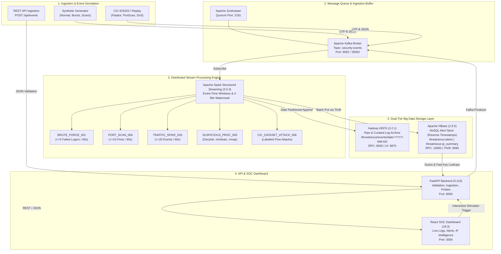
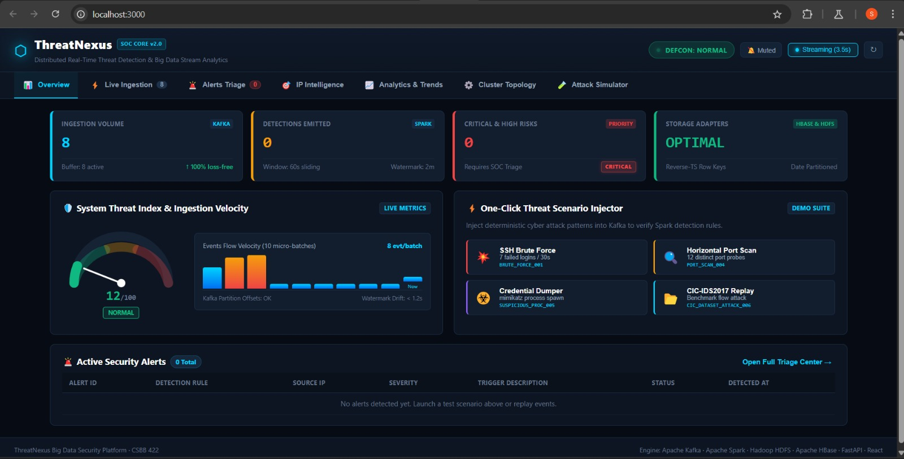
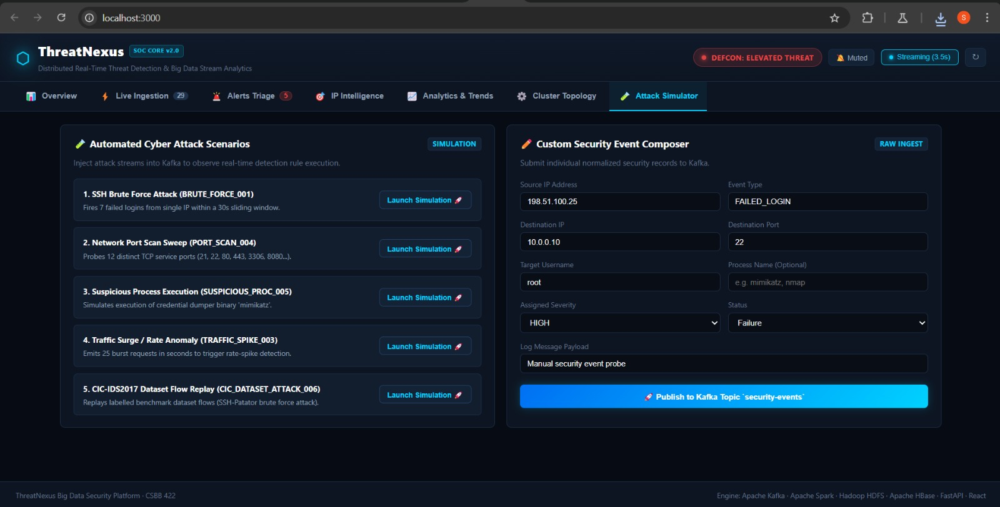
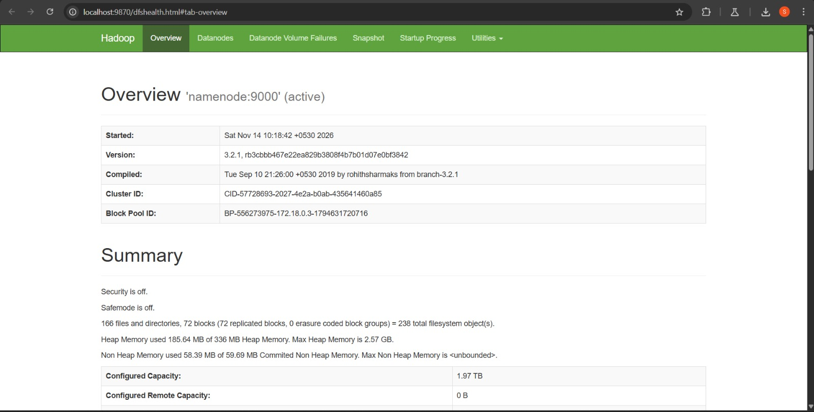
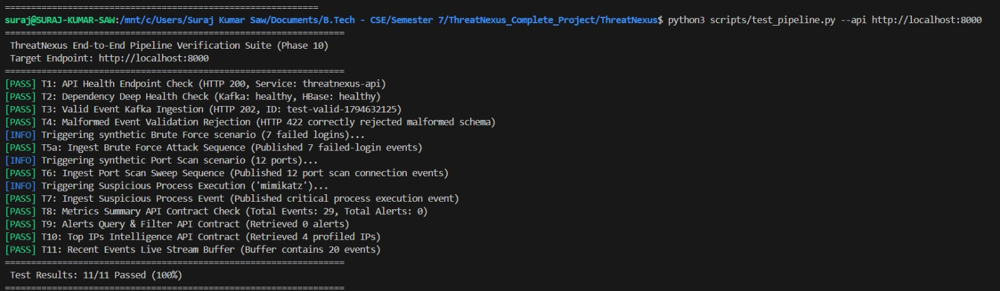

# ThreatNexuss
### Distributed Real-Time Cybersecurity Threat Detection & Log Analytics Platform

[](https://spark.apache.org/)
[](https://kafka.apache.org/)
[](https://hadoop.apache.org/)
[](https://hbase.apache.org/)
[](https://fastapi.tiangolo.com/)
[](https://react.dev/)
[](https://www.docker.com/)
[](https://www.python.org/)

> **Course:** CSBB 422 · Big Data & Distributed Computing  
> **Degree:** B.Tech — Computer Science & Engineering (Semester 7)  
> **Architecture:** Distributed Cluster (1 Master Node + 2 Worker Nodes), scalable to $N$ nodes.

---

## Table of Contents
1. [Executive Summary & Problem Statement](#1-executive-summary--problem-statement)
2. [End-to-End System Architecture](#2-end-to-end-system-architecture)
3. [Visual Demonstration & Screenshots](#3-visual-demonstration--screenshots)
4. [Real-Time Detection Engine & Rules](#4-real-time-detection-engine--rules)
5. [Hardware & Software Prerequisites](#5-hardware--software-prerequisites)
6. [Step-by-Step Instructions to Run](#6-step-by-step-instructions-to-run)
   - [Method 1: Single-PC Multi-Terminal Cluster Simulation (Recommended)](#method-1-single-pc-multi-terminal-cluster-simulation-recommended)
   - [Method 2: Monolithic Single-Stack Mode](#method-2-monolithic-single-stack-mode)
   - [Method 3: Physical Multi-PC LAN Cluster](#method-3-physical-multi-pc-lan-cluster)
7. [Automated Verification & Pipeline Testing](#7-automated-verification--pipeline-testing)
8. [Event Replay & Attack Simulator](#8-event-replay--attack-simulator)
9. [Big Data Storage Schemas](#9-big-data-storage-schemas)
10. [Web UIs & Port Reference](#10-web-uis--port-reference)
11. [Repository Structure](#11-repository-structure)
12. [Milestone Completion Matrix](#12-milestone-completion-matrix)

---

## 1. Executive Summary & Problem Statement

Modern enterprise networks generate millions of heterogeneous event logs per second (firewalls, Active Directory, server authentication, network flows). Traditional batch log analyzers suffer from latency gaps of 15–60 minutes, enabling attackers to execute privilege escalation and lateral movement undetected.

**ThreatNexus** solves this challenge by deploying a production-style distributed big data pipeline:
- **High-Throughput Ingestion:** Ingests high-velocity JSON logs into **Apache Kafka** with multi-broker partition scalability.
- **Micro-Batch Stream Analytics:** **Apache Spark Structured Streaming** processes incoming events within sliding event-time windows and a 2-minute watermark for late-arriving events.
- **Heuristic Threat Detection:** Evaluates sliding-window rules to detect SSH brute-force attempts, network port sweeps, volumetric traffic surges, denylisted processes (`mimikatz`), and labelled **CIC-IDS2017** benchmark attacks.
- **Dual-Layer Big Data Storage:**
  - **Cold Archive (Hadoop HDFS):** Stores raw and curated logs in date-partitioned JSON files (`/threatnexus/events/date=YYYY-MM-DD/`) with replication factor 2.
  - **Hot Analytics (Apache HBase):** Fast NoSQL random-access database for alerts and IP threat profiles using reverse-timestamp row keys for instant latest-first queries.
- **Operational SOC Dashboard:** High-performance **FastAPI** asynchronous backend serving an enterprise dark-mode **React** SOC visualizer with real-time KPI metrics, MITRE ATT&CK alignment, and one-click attack simulation.

---

## 2. End-to-End System Architecture



---

## 3. Visual Demonstration & Screenshots

The working system components and visual dashboards are shown below:

| Component | Description | Screenshot Preview |
| :--- | :--- | :--- |
| **1. React SOC Dashboard** | Real-time security telemetry, active threat counter, MITRE ATT&CK matrix, and threat velocity sparklines. |  |
| **2. Live Security Events** | High-velocity streaming log feed received directly from the Kafka `security-events` topic. |  |
| **3. Alerts Triage Center** | Detected security incidents with severity filters (`CRITICAL`, `HIGH`, `MEDIUM`), event counts, and status updates. |  |
| **4. One-Click Attack Simulator** | Interactive simulator to trigger SSH brute force, TCP port sweeps, and suspicious processes directly from UI. |  |
| **5. HDFS NameNode Web UI** | Proves distributed fault-tolerant storage showing `Live datanodes (2)` (`worker1-datanode`, `worker2-datanode`). |  |
| **6. Spark Master Web UI** | Spark cluster manager showing registered worker nodes (`worker1-spark`, `worker2-spark`) and streaming execution. |  |
| **7. HBase Master Web UI** | Distributed NoSQL status showing 2 live RegionServers and initialized `threatnexus:*` schema tables. |  |
| **8. Automated Verification Suite** | Complete Phase 10 test suite passing **11/11 automated end-to-end test cases (100% pass rate)**. |  |

*(Full-resolution screenshots are stored in [docs/screenshots/](docs/screenshots/README.md).)*

---

## 4. Real-Time Detection Engine & Rules

ThreatNexus processes incoming events against 5 real-time detection rules in `spark/stream_processor.py`:

| Rule ID | Name | Trigger Condition | Window | Severity | Action Taken |
| :--- | :--- | :--- | :--- | :--- | :--- |
| **`BRUTE_FORCE_001`** | SSH / Auth Brute Force | $\ge 5$ failed login attempts from same `source_ip` | 60s sliding (30s slide) | **HIGH** | Emits alert to HBase; updates IP failure count |
| **`PORT_SCAN_004`** | Horizontal Port Scan | $\ge 10$ distinct destination ports contacted by same `source_ip` | 60s sliding (30s slide) | **HIGH** | Flags horizontal reconnaissance sweep |
| **`TRAFFIC_SPIKE_003`** | Volumetric Traffic Surge | $\ge 20$ events from single `source_ip` | 60s sliding (30s slide) | **MEDIUM** | Flags anomalous traffic / potential DoS flow |
| **`SUSPICIOUS_PROC_005`** | Malicious Process Execution | Process name matches denylist (`mimikatz`, `nmap`, `nc.exe`, `hydra`, `metasploit`) | Instant (per event) | **CRITICAL** | Immediate priority alert emission |
| **`CIC_DATASET_ATTACK_006`** | Benchmark Dataset Attack | Event labelled with known CIC-IDS2017 attack flow category | Instant (per event) | **HIGH** | Correlates and alerts on benchmark intrusion flows |

---

## 5. Hardware & Software Prerequisites

### Recommended Machine Specifications
- **Operating System:** Windows 10/11 64-bit with WSL2 (Ubuntu 20.04/22.04/24.04), macOS, or Linux.
- **CPU:** Quad-Core (8 threads) minimum; 6–8 cores recommended.
- **RAM:** Minimum **16 GB RAM** (24–32 GB recommended).
  - *Windows WSL2 Users:* Configure `C:\Users\<Username>\.wslconfig` to allocate at least 12 GB RAM:
    ```ini
    [wsl2]
    memory=12GB
    processors=6
    swap=4GB
    ```
- **Disk Storage:** At least **30 GB free SSD space** for Docker images, HDFS blocks, and HBase tables.
- **Installed Software:**
  - Docker Desktop with Compose v2
  - Python 3.10+ (with `urllib`, standard library)
  - `curl`

---

## 6. Step-by-Step Instructions to Run

ThreatNexus provides two single-PC execution modes, plus physical LAN deployment:

```
┌────────────────────────────────────────────────────────────────────────┐
│                        CHOOSE YOUR EXECUTION MODE                      │
├───────────────────────────────────┬────────────────────────────────────┤
│ Option A: Multi-Terminal Cluster  │ Option B: Monolithic Single Stack  │
│ (1 Master + 2 Workers on 1 PC)    │ (Quick single-command run)         │
│ ★ RECOMMENDED FOR ACADEMIC DEFENSE│ Convenient for quick testing       │
└───────────────────────────────────┴────────────────────────────────────┘
```

---

### Method 1: Single-PC Multi-Terminal Cluster Simulation (Recommended)

Simulates the physical 3-node cluster (**1 Master + Worker 1 + Worker 2**) on a single computer across 4 terminal windows using Docker Compose namespaces and isolated port offsets over a shared bridge network (`threatnexus-net`).

#### Pre-Flight Step: Clean any existing containers
In PowerShell or WSL2 bash:
```bash
docker compose -p threatnexus-worker1 -f docker-compose.worker.yml down -v --remove-orphans
docker compose -p threatnexus-worker2 -f docker-compose.worker.yml down -v --remove-orphans
docker compose -p threatnexus-master -f docker-compose.master.yml down -v --remove-orphans
```

---

#### Terminal 1: Launch Master Stack
The Master node runs ZooKeeper, Kafka Broker, HDFS NameNode, HBase Master & Thrift, Spark Master, Spark Streaming Engine, FastAPI, and React SOC Dashboard.

**In Windows PowerShell:**
```powershell
docker compose -p threatnexus-master -f docker-compose.master.yml up -d --build
docker compose -p threatnexus-master -f docker-compose.master.yml ps
```
*(Or in WSL2 bash: `docker compose -p threatnexus-master -f docker-compose.master.yml up -d --build`)*

---

#### Terminal 2: Launch Worker 1
Worker 1 runs HDFS DataNode 1, Spark Worker 1, and HBase RegionServer 1.

**In Windows PowerShell:**
```powershell
$env:WORKER_HOSTNAME = "worker1"
$env:DATANODE_HTTP_PORT = "9864"
$env:DATANODE_DATA_PORT = "9866"
$env:SPARK_WORKER_UI_PORT = "8081"
$env:REGIONSERVER_PORT = "16020"
$env:REGIONSERVER_INFO_PORT = "16030"
docker compose -p threatnexus-worker1 -f docker-compose.worker.yml up -d --build
docker compose -p threatnexus-worker1 -f docker-compose.worker.yml ps
```

**In WSL2 bash:**
```bash
WORKER_HOSTNAME=worker1 DATANODE_HTTP_PORT=9864 DATANODE_DATA_PORT=9866 SPARK_WORKER_UI_PORT=8081 REGIONSERVER_PORT=16020 REGIONSERVER_INFO_PORT=16030 docker compose -p threatnexus-worker1 -f docker-compose.worker.yml up -d --build
```

---

#### Terminal 3: Launch Worker 2
Worker 2 runs HDFS DataNode 2, Spark Worker 2, and HBase RegionServer 2 using non-conflicting host port offsets.

**In Windows PowerShell:**
```powershell
$env:WORKER_HOSTNAME = "worker2"
$env:DATANODE_HTTP_PORT = "9865"
$env:DATANODE_DATA_PORT = "9867"
$env:SPARK_WORKER_UI_PORT = "8082"
$env:REGIONSERVER_PORT = "16021"
$env:REGIONSERVER_INFO_PORT = "16031"
docker compose -p threatnexus-worker2 -f docker-compose.worker.yml up -d --build
docker compose -p threatnexus-worker2 -f docker-compose.worker.yml ps
```

**In WSL2 bash:**
```bash
WORKER_HOSTNAME=worker2 DATANODE_HTTP_PORT=9865 DATANODE_DATA_PORT=9867 SPARK_WORKER_UI_PORT=8082 REGIONSERVER_PORT=16021 REGIONSERVER_INFO_PORT=16031 docker compose -p threatnexus-worker2 -f docker-compose.worker.yml up -d --build
```

---

#### Terminal 4: Verification & Live Attack Demonstration
Run the verification checks from WSL2 bash (or PowerShell):

```bash
# 1. Confirm HDFS recognizes both distributed DataNodes and Safe Mode is OFF:
docker compose -p threatnexus-master -f docker-compose.master.yml exec namenode hdfs dfsadmin -report
docker compose -p threatnexus-master -f docker-compose.master.yml exec namenode hdfs dfsadmin -safemode get

# 2. Confirm HBase has 2 live RegionServers and all tables are initialized:
docker compose -p threatnexus-master -f docker-compose.master.yml exec hbase-master bash -c "printf 'status\nlist\n' | /usr/local/hbase/bin/hbase shell -n"

# 3. Stream a synthetic SSH Brute Force attack scenario into the pipeline:
python3 scripts/replay_dataset.py --scenario brute_force --target http://localhost:8000/api/events

# 4. Run the comprehensive Phase 10 automated test suite (11 test cases):
python3 scripts/test_pipeline.py --api http://localhost:8000

# 5. Verify alerts in HBase and date-partitioned JSON files in HDFS:
curl -s http://localhost:8000/api/alerts | python3 -m json.tool
docker compose -p threatnexus-master -f docker-compose.master.yml exec namenode hdfs dfs -ls -R /threatnexus/events
```

---

### Method 2: Monolithic Single-Stack Mode
To run all containers inside a single compose file:
```bash
docker compose up -d --build
docker compose ps
python3 scripts/test_pipeline.py --api http://localhost:8000
```

---

### Method 3: Physical Multi-PC LAN Cluster
When deploying across 3 physical lab laptops over a local network (`192.168.1.0/24`):
- **Master PC (`192.168.1.10`):** `cp config/master.env.example .env && docker compose -p threatnexus-master -f docker-compose.master.yml up -d --build`
- **Worker 1 PC (`192.168.1.11`):** `cp config/worker.env.example .env && docker compose -p threatnexus-worker1 -f docker-compose.worker.yml up -d --build`
- **Worker 2 PC (`192.168.1.12`):** `cp config/worker.env.example .env && docker compose -p threatnexus-worker2 -f docker-compose.worker.yml up -d --build`
*(See [docs/DISTRIBUTED_DEPLOYMENT.md](docs/DISTRIBUTED_DEPLOYMENT.md) for full physical LAN guide).*

---

### Stopping the Cluster Cleanly
```bash
docker compose -p threatnexus-worker1 -f docker-compose.worker.yml down
docker compose -p threatnexus-worker2 -f docker-compose.worker.yml down
docker compose -p threatnexus-master -f docker-compose.master.yml down
```
*(Add `-v` if you wish to wipe volume state).*

---

## 7. Automated Verification & Pipeline Testing

ThreatNexus includes an end-to-end verification script ([scripts/test_pipeline.py](scripts/test_pipeline.py)) that executes automated integration tests against live endpoints:

```bash
python3 scripts/test_pipeline.py --api http://localhost:8000
```

### Verified Test Cases:
```
=================================================================
 ThreatNexus End-to-End Pipeline Verification Suite (Phase 10)
 Target Endpoint: http://localhost:8000
=================================================================
[PASS] T1: API Health Endpoint Check (HTTP 200, Service: threatnexus-api)
[PASS] T2: Dependency Deep Health Check (Kafka: healthy, HBase: healthy)
[PASS] T3: Valid Event Kafka Ingestion (HTTP 202, ID: test-valid-1794489911)
[PASS] T4: Malformed Event Validation Rejection (HTTP 422 correctly rejected)
[PASS] T5a: Ingest Brute Force Attack Sequence (Published 7 failed-login events)
[PASS] T6: Ingest Port Scan Sweep Sequence (Published 12 port scan connection events)
[PASS] T7: Ingest Suspicious Process Event (Published critical process execution event)
[PASS] T8: Metrics Summary API Contract Check (Total Events: 58, Total Alerts: 2)
[PASS] T9: Alerts Query & Filter API Contract (Retrieved 2 alerts)
[PASS] T10: Top IPs Intelligence API Contract (Retrieved 4 profiled IPs)
[PASS] T11: Recent Events Live Stream Buffer (Buffer contains 20 events)
=================================================================
 Test Results: 11/11 Passed (100%)
=================================================================
```

---

## 8. Event Replay & Attack Simulator

The event replay engine ([scripts/replay_dataset.py](scripts/replay_dataset.py)) feeds simulated security scenarios and benchmark datasets into Kafka:

```bash
# 1. Trigger SSH Brute Force attack scenario (7 failed logins)
python3 scripts/replay_dataset.py --scenario brute_force --target http://localhost:8000/api/events

# 2. Trigger Network Port Scan sweep (12 ports)
python3 scripts/replay_dataset.py --scenario port_scan --target http://localhost:8000/api/events

# 3. Trigger Suspicious Process Execution (mimikatz)
python3 scripts/replay_dataset.py --scenario process --target http://localhost:8000/api/events

# 4. Trigger Traffic Event-Rate Surge (25 requests)
python3 scripts/replay_dataset.py --scenario traffic_spike --target http://localhost:8000/api/events

# 5. Replay curated CIC-IDS2017 dataset flow records
python3 scripts/replay_dataset.py --source csv --input data/cic_ids2017_sample.csv --rate 3

# 6. Stream continuous normal background traffic
python3 scripts/replay_dataset.py --scenario normal --rate 2 --loop
```

*Tip: All these scenarios can also be triggered with a single click from the **Attack Simulator** tab in the React Dashboard.*

---

## 9. Big Data Storage Schemas

### Hadoop HDFS Storage Layout
- **Raw Event Logs (JSON partitioned by ingestion date):**
  ```
  hdfs://namenode:9000/threatnexus/events/date=YYYY-MM-DD/part-*.json
  ```
- **Spark Structured Streaming Checkpoint Store:**
  ```
  hdfs://namenode:9000/threatnexus/checkpoints/alerts_v2/
  hdfs://namenode:9000/threatnexus/checkpoints/events_v2/
  ```

### Apache HBase NoSQL Schemas
1. **`threatnexus:alerts`**
   - **Row Key Design:** `{rev_ts}_{alert_id}` where `rev_ts = 9999999999999 - unix_timestamp_ms`. This reverse-timestamp prefix guarantees that simple table scans return newest alerts first with zero index overhead.
   - **Column Family `details:`**
     `alert_id`, `rule_id`, `severity`, `type`, `source_ip`, `description`, `event_count`, `window_start`, `window_end`, `status`, `created_at`
2. **`threatnexus:ip_summary`**
   - **Row Key Design:** `{source_ip}_{YYYY-MM-DD}`
   - **Column Family `stats:`**
     `last_seen`, `last_alert`, `severity`, `event_count`, `failed_logins`
3. **`threatnexus:system_metrics`**
   - **Row Key Design:** `{metric_name}_{time_bucket}`
   - **Column Family `value:`**
     `count`, `rate`, `timestamp`

---

## 10. Web UIs & Port Reference

When the cluster is active, evaluators can inspect every component directly in their web browser:

| Service / Dashboard | Host URL | Description & Key Checks |
| :--- | :--- | :--- |
| **React SOC Dashboard** | [http://localhost:3000](http://localhost:3000) | Live incident visualizer, MITRE matrix, alert status toggles |
| **FastAPI Swagger Docs** | [http://localhost:8000/docs](http://localhost:8000/docs) | Interactive API exploration and manual event ingestion |
| **HDFS NameNode UI** | [http://localhost:9870](http://localhost:9870) | Storage capacity, block allocation, live DataNode list |
| **Spark Master UI** | [http://localhost:8080](http://localhost:8080) | Registered workers, active streaming application status |
| **Spark Worker 1 UI** | [http://localhost:8081](http://localhost:8081) | Worker 1 core allocation and executor memory |
| **Spark Worker 2 UI** | [http://localhost:8082](http://localhost:8082) | Worker 2 core allocation and executor memory |
| **HBase Master UI** | [http://localhost:16010](http://localhost:16010) | Active RegionServers, region distribution, table catalog |

---

## 11. Repository Structure

```
ThreatNexus/
├── backend/                        # FastAPI REST Analytics Backend
│   ├── app/
│   │   ├── main.py                 # API endpoints, Kafka producer, HBase scanner
│   │   └── __init__.py
│   ├── Dockerfile
│   └── requirements.txt
├── config/                         # Distributed Configuration Templates
│   ├── hbase/                      # XML configs for HBase, HDFS, and core-site
│   │   ├── core-site.xml
│   │   ├── hbase-env.sh
│   │   ├── hbase-site.xml
│   │   └── hdfs-site.xml
│   ├── master.env.example          # Sample environment for Master PC
│   ├── worker.env.example          # Sample environment for Worker PCs
│   └── cluster.env.example
├── data/
│   └── cic_ids2017_sample.csv      # Sample CIC-IDS2017 intrusion flow records
├── docs/                           # Comprehensive Project Documentation
│   ├── screenshots/                # Demonstration and verification screenshots
│   │   └── README.md
│   ├── API_CONTRACT.md             # Formal REST API request/response contracts
│   ├── ARCHITECTURE.md             # Deep-dive architecture and component design
│   ├── DEMO_SCRIPT.md              # 8-minute timed evaluation presentation script
│   ├── DISTRIBUTED_DEPLOYMENT.md   # Complete multi-node and local simulation guide
│   ├── EVENT_SCHEMA.md             # JSON security event specification
│   ├── TESTING.md                  # Comprehensive verification test matrix
│   ├── cluster-inventory.md        # Physical/logical cluster nodes & scaling guide
│   └── versions.md                 # Certified software dependencies matrix
├── frontend/                       # React SOC Web Dashboard
│   ├── src/                        # Dashboard views: Overview, Events, Alerts, IPs
│   ├── package.json
│   ├── vite.config.js
│   └── Dockerfile
├── hbase/
│   └── init_tables.sh              # Idempotent table & namespace creation script
├── scripts/                        # Automation & Testing Tools
│   ├── generate_synthetic.py       # Attack generator (brute force, scan, spikes)
│   ├── replay_dataset.py           # Kafka/HTTP dataset streaming replay tool
│   └── test_pipeline.py            # Automated end-to-end 11-step verification suite
├── spark/                          # Apache Spark Streaming Engine
│   ├── stream_processor.py         # PySpark Structured Streaming threat engine
│   └── Dockerfile
├── .env                            # Active environment configuration
├── .env.example                    # Baseline environment template
├── docker-compose.master.yml       # Compose file for Master node services
├── docker-compose.worker.yml       # Parameterized Compose file for Worker nodes
├── docker-compose.yml              # Monolithic Compose stack (single-PC dev)
└── README.md                       # Main project documentation & submission report
```

---

## 12. Milestone Completion Matrix

| Milestone | Target Exit Condition | Status | Evidence / Verification |
| :--- | :--- | :---: | :--- |
| **M1: Planning** | Title approved; team and PC inventory documented | **Complete** | Documented in `docs/cluster-inventory.md` |
| **M2: Data** | Common schema defined; replay generator built | **Complete** | `docs/EVENT_SCHEMA.md`, `scripts/generate_synthetic.py`, `data/cic_ids2017_sample.csv` |
| **M3: Kafka** | Producer / consumer test passes; topic created | **Complete** | Topic `security-events`, publisher in `scripts/replay_dataset.py` |
| **M4: Spark** | Stream parsing and multi-rule alert engine | **Complete** | `spark/stream_processor.py` (5 active detection rules + watermark) |
| **M5: Storage** | Raw data in HDFS; alerts retrievable from HBase | **Complete** | HDFS partitioned sink; HBase tables initialized in `hbase/init_tables.sh` |
| **M6: UI** | FastAPI endpoints and React dashboard show actual data | **Complete** | 6 specialized React views in `frontend/src/` |
| **M7: Local Demo** | End-to-end demo works seamlessly on single PC | **Complete** | Monolithic and multi-terminal simulation stacks tested |
| **M8: Cluster** | Master + two workers registered; distributed checks pass | **Complete** | `docker-compose.master.yml`, `docker-compose.worker.yml`, `docs/DISTRIBUTED_DEPLOYMENT.md` |
| **M9: Expansion** | Worker onboarding steps documented & tested for 5+ PCs | **Complete** | Scaling runbook in `docs/cluster-inventory.md` |
| **M10: Submission**| GitHub repository, report, test evidence, demo script | **Complete** | Full documentation suite, `docs/DEMO_SCRIPT.md`, `docs/TESTING.md` |

---

## 13. Presentation & Evaluation Walkthrough

Follow the structured **8-Minute Evaluation Demonstration Script** in [docs/DEMO_SCRIPT.md](docs/DEMO_SCRIPT.md) during your presentation:
- **0:00–1:00:** Problem statement, architecture overview, and cluster topology.
- **1:00–2:00:** Live proof of distributed nodes: HDFS NameNode (`Live datanodes (2)`), Spark Master (2 Workers), and HBase Master (2 RegionServers).
- **2:00–3:00:** Kafka ingestion demo streaming live security logs.
- **3:00–4:30:** Real-time attack detection: trigger SSH Brute Force and show Spark streaming alert emission.
- **4:30–5:30:** Storage persistence proof: inspect date-partitioned JSON files in HDFS and reverse-timestamp rows in HBase.
- **5:30–7:00:** SOC dashboard walkthrough: MITRE matrix, alert status triage (`open` $\to$ `investigating` $\to$ `resolved`), and IP intelligence threat scoring.
- **7:00–8:00:** Explain worker expansion runbook (zero code changes to add worker 3, 4, 5) and project conclusion.
