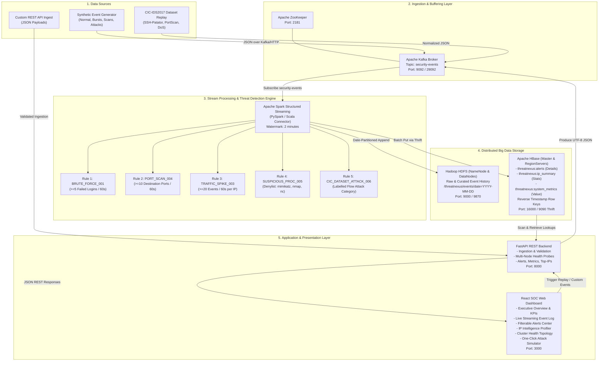

# ThreatNexus Architecture Reference
**System Title:** Distributed Real-Time Cybersecurity Threat Detection & Log Analytics Platform

---

## 1. End-to-End System Architecture

---

## 2. Component Responsibilities & Verification

| Technology | Responsibility | What to Demonstrate in Demo |
| :--- | :--- | :--- |
| **Apache Kafka** | Buffers and distributes high-throughput incoming security events with zero loss. | Producer publishes UTF-8 JSON events; Spark consumer reads topic partition offsets. |
| **Apache Spark Structured Streaming** | Parses JSON, manages event-time windows and 2-min watermarks, evaluates detection rules, and outputs alerts. | Streaming query metrics, micro-batch processing logs, and real-time alert trigger emission. |
| **Hadoop HDFS** | Distributed fault-tolerant storage for historical raw and curated event logs. | HDFS NameNode Web UI (`:9870`), date-partitioned event directories (`/threatnexus/events/date=...`), live DataNode block reports. |
| **Apache HBase** | Distributed NoSQL column store for rapid random lookups of alerts, IP intelligence, and system metrics. | Reverse-timestamp row keys for fast latest-first scans; HBase shell table scans (`scan 'threatnexus:alerts'`). |
| **FastAPI Backend** | High-performance async REST API providing data ingestion, validation, health monitoring, and analytics endpoints. | Swagger UI (`/docs`), `/api/health` multi-node probe, `/api/alerts`, `/api/top-ips`. |
| **React Dashboard** | Professional SOC dark-mode web application providing real-time visibility into security events and alerts. | Real-time KPI cards, live event stream, interactive alerts triage, IP threat scoring, cluster topology status. |

---

## 3. Storage Schemas

### Hadoop HDFS Storage Layout
- Raw & Curated Event Logs:
  `hdfs://namenode:9000/threatnexus/events/date=YYYY-MM-DD/part-*.json`
- Streaming Checkpoints:
  `hdfs://namenode:9000/threatnexus/checkpoints/alerts_v2/`
  `hdfs://namenode:9000/threatnexus/checkpoints/events_v2/`

### Apache HBase Table Schema
1. **`threatnexus:alerts`**
   - **Row Key:** `{rev_ts}_{alert_id}` (where `rev_ts = 9999999999999 - unix_ms`)
   - **Column Family `details:`**
     `alert_id`, `rule_id`, `severity`, `type`, `source_ip`, `description`, `event_count`, `window_start`, `window_end`, `status`, `created_at`
2. **`threatnexus:ip_summary`**
   - **Row Key:** `{source_ip}_{YYYY-MM-DD}`
   - **Column Family `stats:`**
     `last_seen`, `last_alert`, `severity`, `event_count`, `failed_logins`
3. **`threatnexus:system_metrics`**
   - **Row Key:** `{metric_name}_{time_bucket}`
   - **Column Family `value:`**
     `count`, `rate`, `timestamp`
